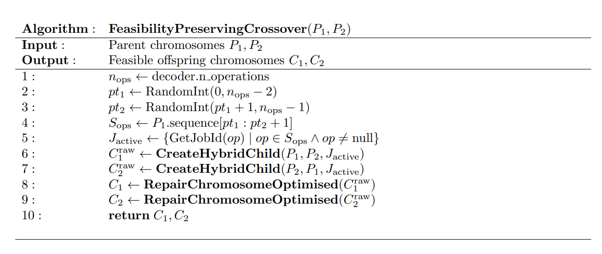
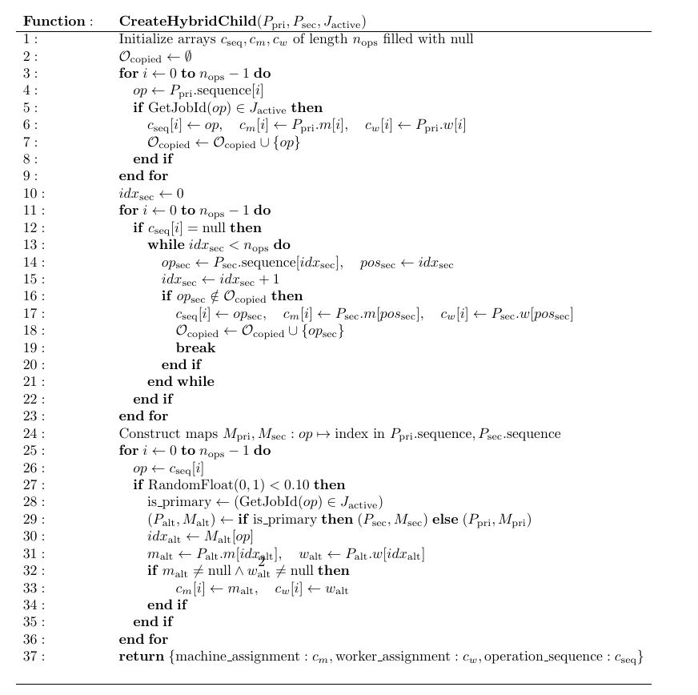
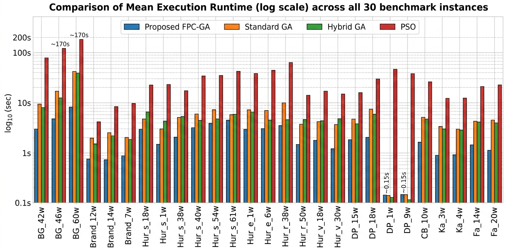
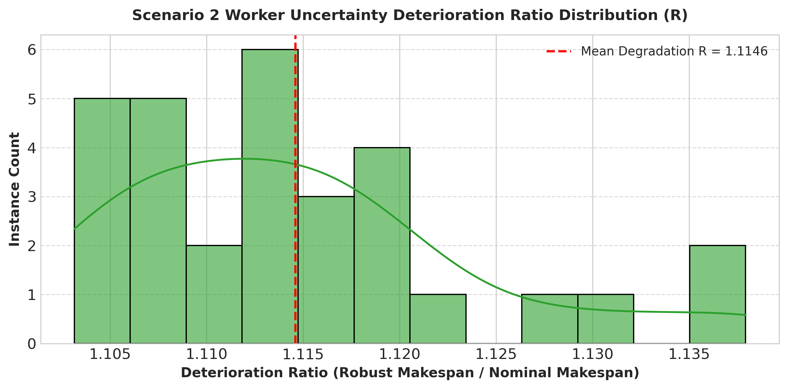

# FJSSP-WU Genetic Algorithm Framework

An optimization framework for solving the Flexible Job Shop Scheduling Problem with Worker Uncertainty (`FJSSP-WU`). This solver handles operation precedence, flexible machine routing, and worker assignment constraints under both deterministic operational conditions and stochastic worker uncertainty/disruption scenarios.

---

## Table of Contents

- [Overview](#overview)
- [Algorithm & Pseudocode](#algorithm--pseudocode)
  - [Crossover Mechanics](#crossover-mechanics)
  - [Pseudocode](#pseudocode)
- [Experimental Results & Benchmark Evaluation](#experimental-results--benchmark-evaluation)
- [Repository Layout](#repository-layout)
- [Requirements & Installation](#requirements--installation)
- [Usage & Execution](#usage--execution)
  - [Master Orchestrator](#1-master-orchestrator-run_allpy)
  - [Post-Processing & Analysis](#2-submission-generation--analysis)

---

## Overview

* **Feasibility-Preserving Crossover:** Combines Order Crossover (OX) with job-level grouping and uniform assignment blending to ensure precedence validity and effective solution space exploration.
* **Dual-Scenario Evaluation:** Supports both deterministic scheduling (`Scenario 1`) and stochastic disruption/uncertainty scenarios (`Scenario 2`).
* **Automated Repair Mechanism:** Includes chromosome repair operators (`repair_chromosome_optimised`) to enforce constraint satisfaction post-crossover.
* **Experiment Pipeline:** Includes automated scripts for running baselines, scenario benchmarks, competition submission packaging, and report table generation.

---
# Algorithm & Pseudocode
## Crossover Mechanics
**Phase 1: Localized Temporal Slicing**

A contiguous spatial window `[pt1, pt2]` is randomly initialized on Parent 1's operation sequence. The subset of unique jobs executing within this chronological window is extracted into an `active_jobs` set.

**Phase 2: Spatial & Synergistic Anchoring**

Operations corresponding to the `active_jobs` set are inherited by the offspring at their exact sequence indices. This preserves both the chronological timing and the primary `Machine-Worker` assignment synergies of the localized bottleneck.

**Phase 3: Relative Topological Fill**

The remaining unallocated sequence indices in the offspring are populated sequentially using the operations from Parent 2, strictly preserving their relative order of appearance to maintain global job precedence.

**Phase 4: Uniform Synergistic Blending**

To inject localized genetic diversity, each gene position undergoes a uniform 10% probability check. If triggered, the gene's `Machine-Worker` allocation pair is swapped with the alternate parent's assignment via an `O(1)` lookup table, facilitating rapid resource exploration.

**Phase 5: Feasibility Restoration**

The resultant offspring is passed through an optimized deterministic repair heuristic (`repair_chromosome_optimised`) to resolve any residual precedence violations or dual-resource allocation conflicts, guaranteeing strict constraint adherence.


## Pseudocode



---
## Experimental Results & Benchmark Evaluation
The proposed `Proposed_FPC_GA` solver was evaluated across 30 standard FJSSP-WU benchmark instances against three baseline algorithms: `Standard_GA`, `Hybrid_GA`, and `Particle Swarm Optimization (PSO)`.

### Key Performance Highlights

**Highest Win Rate:** `Proposed_FPC_GA` achieved the best mean makespan on 17 out of 30 benchmark instances (56.7%), outperforming `Hybrid_GA` (13 wins), `Standard_GA` (0 wins), and `PSO` (0 wins).

**Improved Execution Efficiency:** `Proposed_FPC_GA` runs in 1.57s average execution time, making it $2.02\times$ faster than `Standard_GA` (3.17s), $2.12\times$ faster than `Hybrid_GA (3.32s)`, and $5.64\times$ faster than `PSO` (8.86s).

**Function Evaluation Reduction:** Requires an average of only 514.2 Function Evaluations (FEVs) per run—a $64\%\text{--}68\%$ reduction compared to `Standard_GA` (1430.0 FEVs), `Hybrid_GA` (1616.7 FEVs), and `PSO` (1530.0 FEVs).

**Robustness Under Worker Disruption:** Under Scenario 2 stochastic worker uncertainty, the framework maintains an average degradation ratio, $R = \frac{C_{\max}^{\text{robust}}}{C_{\max}^{\text{nominal}}}$,  of 1.1146 ($\sim 11.46\%$ average degradation).
### Graphs & Tables

<summary><b>Graph 1: Mean Runtime For 30 Instances</b></summary>


</details>
<summary><b>Graph 2: Uncertainty Deterioration Ratio</b></summary>


</details>

<details>
Averaged performance statistics across all 30 benchmark instances (30 independent runs per instance)
<summary><b>Table 1: Overall Performance Summary</b></summary>

| Algorithm | Mean Makespan (C<sub>max</sub>) | Median Makespan | Std Dev | Wins (Mean) | Wins (Best) | Mean Rank | Mean FEV | Mean Runtime (s) |
| :--- | :---: | :---: | :---: | :---: | :---: | :---: | :---: | :---: |
| `Proposed_FPC_GA` | 1898.0 | 1209.0 | 2072.2 | 17 | 15 | 1.73 | 514.2 | 1.57 |
| `Hybrid_GA` | 1903.3 | 1236.0 | 2050.3 | 13 | 15 | 1.57 | 1616.7 | 3.32 |
| `Standard_GA` | 1918.6 | 1265.0 | 2070.0 | 0 | 0 | 2.70 | 1430.0 | 3.17 |
| `PSO` | 2281.8 | 1448.5 | 2468.5 | 0 | 0 | 4.00 | 1530.0 | 8.86 |

</details>
<details>
Breakdown of mean makespan and improvement percentage of Proposed_FPC_GA over Standard_GA across 10 benchmark families.
<summary><b>Table 2: Algorithm Performance Comparison</b></summary>

| Family Name | Instances | `Proposed_FPC_GA` | `Hybrid_GA` | `Standard_GA` | `PSO` | Best Algorithm | `FPC-GA` vs `Standard GA` (%) |
| :--- | :---: | :---: | :---: | :---: | :---: | :--- | :---: |
| Kacem | 2 | 19.48 | 34.73 | 34.88 | 47.02 | `Proposed_FPC_GA` | +44.15% |
| Behnke-Geiger | 3 | 255.46 | 306.89 | 308.43 | 344.30 | `Proposed_FPC_GA` | +17.18% |
| Fattahi | 2 | 1041.12 | 1143.65 | 1153.12 | 1372.57 | `Proposed_FPC_GA` | +9.71% |
| Brandimarte | 3 | 655.41 | 690.59 | 694.44 | 815.84 | `Proposed_FPC_GA` | +5.62% |
| Chambers-Barnes | 1 | 1405.47 | 1452.67 | 1464.50 | 1698.67 | `Proposed_FPC_GA` | +4.03% |
| Hurink edata | 2 | 362.17 | 365.42 | 368.22 | 434.88 | `Proposed_FPC_GA` | +1.64% |
| Hurink rdata | 3 | 4029.60 | 4018.81 | 4054.70 | 4870.80 | `Hybrid_GA` | +0.62% |
| Hurink vdata | 3 | 1469.11 | 1460.04 | 1473.87 | 1811.57 | `Hybrid_GA` | +0.32% |
| Hurink sdata | 7 | 2325.38 | 2299.05 | 2324.10 | 2733.09 | `Hybrid_GA` | -0.06% |
| DPpaulli | 4 | 4295.96 | 4259.28 | 4279.47 | 5096.63 | `Hybrid_GA` | -0.39% |

</details>

<details>
Pairwise Statistical Tests & Effect SizesPairwise comparisons using the Wilcoxon signed-rank test and Vargha-Delaney $A_{12}$ effect size against Proposed_FPC_GA ($\alpha = 0.05$)
<summary><b>Table 3: Statistical Comparison</b></summary>

| Baseline Algorithm | Proposed Mean | Baseline Mean | Per-Instance W/T/L | Wilcoxon W Stat | Raw p-value | Bonferroni p-value | Vargha-Delaney A<sub>12</sub> | Effect Size |
| :--- | :---: | :---: | :---: | :---: | :---: | :---: | :---: | :---: |
| `PSO` | 1898.0 | 2281.8 | 30/0/0 | 0.0 | < 0.0001 | < 0.0001 | 0.991 | Large |
| `Standard_GA` | 1898.0 | 1918.6 | 12/12/6 | 141.0 | 0.0606 | 0.1817 | 0.647 | Medium |
| `Hybrid_GA` | 1898.0 | 1903.3 | 12/11/7 | 193.0 | 0.4280 | 1.0000 | 0.609 | — |

</details>

---
## Repository Layout

```text
FJSP/                               # Root repository for FJSP framework
├── code-archive/                   # Legacy code versions
├── data-sample/               
├── debug-scripts/              
├── FJSSP-W-Competition/        
├── images/                         # Charts, figures, and plots
├── results/                 
├── src/                            # Primary source code directory
│   ├── analysis/               
│   ├── baselines/                  # Baseline algorithm implementations (GA, PSO, etc.)
│   │   ├── __init__.py
│   │   ├── hybrid_ga.py
│   │   ├── pso.py
│   │   ├── robust_ga.py
│   │   └── standard_ga.py
│   ├── experiments/                # Experiment execution scripts
│   │   ├── results/                # Sub-directory for experiment-specific output files
│   │   ├── generate_submissions_v2.py
│   │   ├── run_baseline.py
│   │   └── run_fjssp_w_parallel_v2.py
│   ├── ga/                         # Core Genetic Algorithm logic and schedule decoders
│   │   ├── fjssp_w/                # Sub-module for FJSSP-W specific variant
│   │   │   ├── __init__.py
│   │   │   ├── decoder_w.py
│   │   │   ├── genetic_algorithm_w_v2.py
│   │   │   └── uncertainty_sim.py
│   │   ├── decoder.py
│   │   ├── genetic_algorithm.py
│   │   └── sanity_check.py
│   ├── parser/                     # Problem instance data loaders and parsers
│   ├── results/                    # Module-level experiment outputs
│   ├── uncertainty/                # Uncertainty modeling and stochastic simulation components
│   ├── util/                  
│   └── visualization/          
├── .gitignore
├── build_competition_package.py
├── full_analysis.py
├── launch_runner.py
├── README.md
├── report_tables.py
├── requirements.txt
├── run_all_parallel.py
├── run_baselines_parallel.py
├── run_scenario1_parallel_v2.py
└── run_scenario2_parallel_v2.py
```
---
# Requirements & Installation
Environment
`Python 3.9+`
`Virtual Environment 21.2.4+`

## Dependencies
Install the required dependencies via pip:
```bash
pip install -r requirements.txt
```
---
# Usage & Execution
## 1. Master Orchestrator (`run_all_parallel.py`)
Run experiments, baselines, and submission workflows through the central CLI interface:

```bash
# Run complete pipeline (Scenario 1, Scenario 2, Baselines, Submission)
python run_all_parallel.py all

# Run Scenario 1 only (Deterministic)
python run_all_parallel.py s1

# Run Scenario 2 only (Uncertainty)
python run_all_parallel.py s2

# Run baseline comparisons only
python run_all_parallel.py baselines

# Generate competition submission files
python run_all_parallel.py submission
```
## 2. Submission Generation & Analysis
To run stand-alone submission generation, package files, and output analytical tables:
```bash
# Generate submission files for all scenarios
python src/experiments/generate_submissions_v2.py all

# Build competition package archive
python build_competition_package.py

# Execute complete experimental analysis
python full_analysis.py

# Generate report summary tables
python report_tables.py
```
