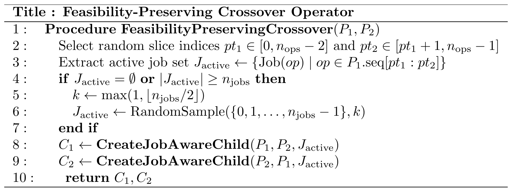
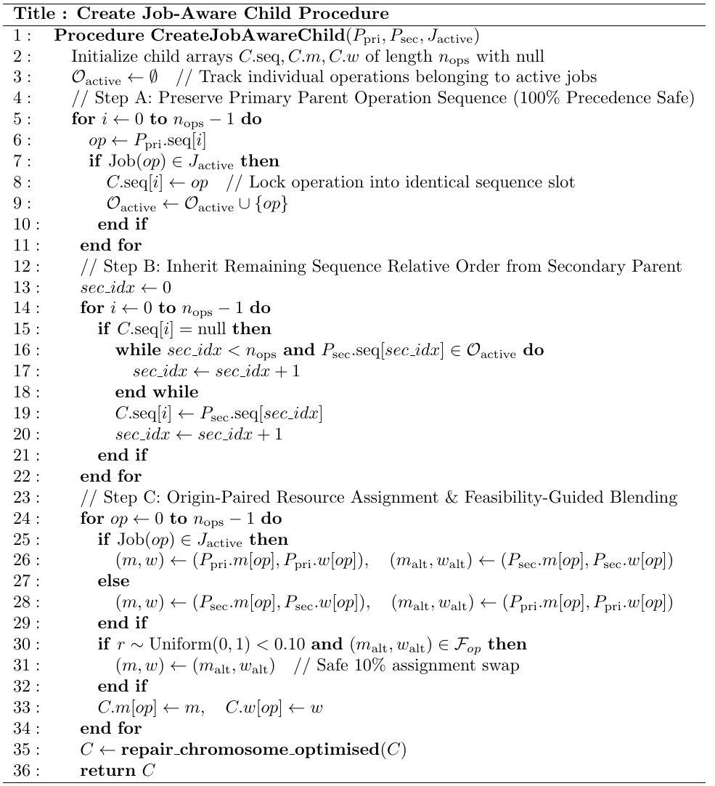
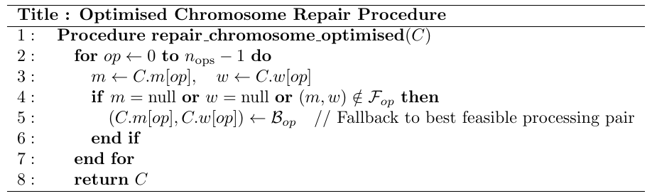
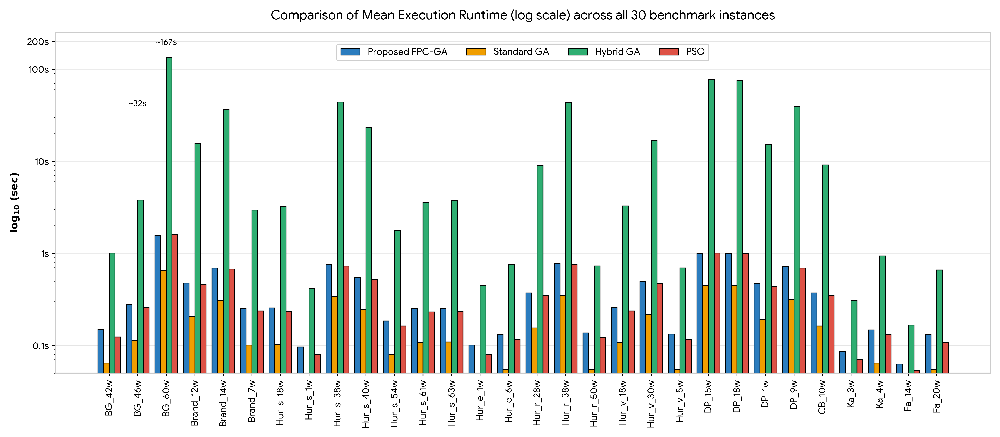
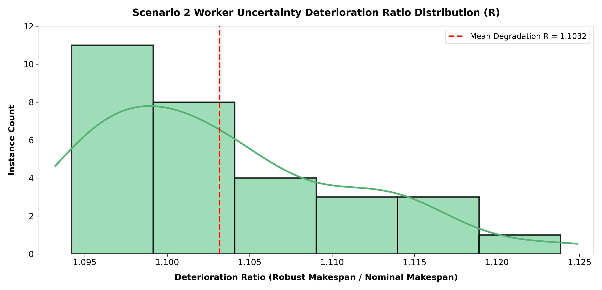

# FJSSP-WU Genetic Algorithm Framework

An optimization framework for solving the Flexible Job Shop Scheduling Problem with Worker Uncertainty (`FJSSP-WU`). This solver handles operation precedence, flexible machine routing, and worker assignment constraints under both deterministic operational conditions and stochastic worker uncertainty/disruption scenarios.

---

## Table of Contents

- [Overview](#overview)
- [Algorithm & Pseudocode](#algorithm--pseudocode)
  - [Crossover Mechanics](#crossover-mechanics)
  - [Pseudocode](#pseudocode)
- [Experimental Results & Benchmark Evaluation](#experimental-results--benchmark-evaluation)
  - [Key Performance Highlights](#key-performance-highlights)
  - [Graphs & Tables](#graphs--tables)
- [Repository Layout](#repository-layout)
- [Requirements & Installation](#requirements--installation)
- [Usage & Execution](#usage--execution)
  - [Master Orchestrator](#1-master-orchestrator-run_allpy)
  - [Post-Processing & Analysis](#2-submission-generation--analysis)

---

## Overview

* **Feasibility-Preserving Crossover:** Combines Order Crossover (OX) with job-level grouping and uniform assignment blending to ensure precedence validity and effective solution space exploration.
* **Dual-Scenario Evaluation:** Supports both deterministic scheduling (`Scenario 1`) and stochastic disruption/uncertainty scenarios (`Scenario 2`).
* **Automated Repair Mechanism:** Includes chromosome repair operators (`repair_chromosome_optimised`) to enforce constraint satisfaction post-crossover.
* **Experiment Pipeline:** Includes automated scripts for running baselines, scenario benchmarks, competition submission packaging, and report table generation.

---
# Algorithm & Pseudocode
## Crossover Mechanics
**Phase 1: Localized Slice Extraction**

A contiguous window $[pt_1, pt_2]$ is drawn at random on Parent 1's operation
sequence, and the set of job IDs appearing in it forms the active set
$J_{\text{active}}$. If the window covers every job in the instance, the slice is
discarded and $J_{\text{active}}$ is instead a random subset of $\lfloor J/2 \rfloor$
jobs (at least one), so that the offspring always inherits from both parents.

**Phase 2: Sequence & Resource Anchoring**

Operations belonging to $J_{\text{active}}$ are copied into the offspring sequence at
their exact positions from Parent 1, together with Parent 1's machine–worker pair
for each of those operations.

**Phase 3: Relative Fill from Parent 2**

The remaining positions are filled from left to right with Parent 2's remaining
operations, in their original relative order of appearance. Each operation keeps
the machine–worker pair it had in Parent 2 (origin-paired inheritance). Because
the operation sequence is a priority list and the decoder releases an operation only
after its job predecessor has finished, every permutation is valid, so no
sequence repair is needed.

**Phase 4: Feasibility-Guided Assignment Exchange**

Each operation independently has a 10% probability of having its inherited
machine–worker pair replaced by the pair the other parent holds for the same
operation. The replacement is accepted only if it passes an $O(1)$ set-membership
check against that operation's feasible pairs.

**Phase 5: Resource Feasibility Safeguard**

The offspring is passed through `repair_chromosome_optimised`. Any missing or
infeasible machine–worker pair is replaced by the operation's precomputed fastest
feasible pair ($\mathcal{B}_{op}$). Since both parents are feasible and Phase 4
is checked, this step rarely triggers and acts as a safeguard.

**Operator-level notes**

The second offspring is built symmetrically with the parents' roles exchanged,
using the same $J_{\text{active}}$. Crossover is applied with probability 0.8;
otherwise the parents are passed unchanged to mutation.


## Pseudocode




---
## Experimental Results & Benchmark Evaluation
The proposed `Proposed_FPC_GA` solver was evaluated across 30 standard FJSSP-WU benchmark instances against three baseline algorithms: `Standard_GA`, `Hybrid_GA`, and `Particle Swarm Optimization (PSO)`.

### Key Performance Highlights

* **Highest Win Rate:** `Proposed_FPC_GA` achieved the best mean makespan on **16 out of 30** benchmark instances (**53.3%**), outperforming `Hybrid_GA` (13 wins), `Standard_GA` (1 win), and `PSO` (0 wins).
* **Improved Execution Efficiency:** `Proposed_FPC_GA` executes in **0.41s** average execution time, making it **$46.32\times$ faster** than `Hybrid_GA` (18.99s) while delivering superior overall solution quality.
* **Function Evaluation Efficiency:** Requires an average of **1,374.94** Function Evaluations (FEVs) per run—a **$97.8\%$ reduction** compared to `Hybrid_GA` (63,773.67 FEVs) and a **$10.1\%$ reduction** compared to `PSO` (1,529.66 FEVs).
* **Robustness Under Worker Disruption:** Under Scenario 2 stochastic worker uncertainty, the framework maintains an average degradation ratio, $R = \frac{C_{\max}^{\text{robust}}}{C_{\max}^{\text{nominal}}}$, of **1.1032** (**$\sim 10.32\%$ average degradation**) across all 30 test instances.

---

### Graphs & Tables

### Graph 1: Mean Runtime For 30 Instances



### Graph 2: Uncertainty Deterioration Ratio</b></summary>



### Table 1: Overall Performance Summary

Averaged performance statistics across all 30 benchmark instances (30 independent runs per instance):

| Algorithm | Mean Makespan ($C_{\max}$) | Median Makespan | Std Dev | Wins (Mean) | Wins (Best) | Mean Rank | Mean FEV | Mean Runtime (s) |
| :--- | :---: | :---: | :---: | :---: | :---: | :---: | :---: | :---: |
| `Proposed_FPC_GA` | **3,214.30** | **1,799.50** | **3,490.30** | **16** | **16** | **1.50** | 1,374.94 | 0.41 |
| `Hybrid_GA` | 3,250.60 | 1,809.00 | 3,566.10 | 13 | 14 | 1.60 | 63,773.67 | 18.99 |
| `Standard_GA` | 3,465.10 | 1,907.00 | 3,780.30 | 1 | 0 | 2.90 | **727.51** | **0.18** |
| `PSO` | 4,187.30 | 2,462.50 | 4,507.20 | 0 | 0 | 4.00 | 1,529.66 | 0.39 |


#### Table 2: Algorithm Performance Comparison

Breakdown of mean makespan and improvement percentage of `Proposed_FPC_GA` over `Standard_GA` across 10 benchmark families:

| Family Name | Instances | Proposed_FPC_GA | Hybrid_GA | Standard_GA | PSO | Best Algorithm | FPC-GA vs Standard GA (%) |
| :--- | :---: | :---: | :---: | :---: | :---: | :--- | :---: |
| Kacem | 2 | 19.73 | 21.72 | 21.80 | 35.40 | `Proposed_FPC_GA` | +9.48% |
| Behnke-Geiger | 3 | 314.66 | 361.79 | 384.56 | 523.00 | `Proposed_FPC_GA` | +18.18% |
| Hurink edata | 2 | 494.95 | 479.42 | 505.98 | 600.75 | `Hybrid_GA` | +2.18% |
| Brandimarte | 3 | 1,041.54 | 1,008.50 | 1,097.29 | 1,449.11 | `Hybrid_GA` | +5.08% |
| Fattahi | 2 | 1,318.58 | 1,300.95 | 1,353.47 | 1,751.33 | `Hybrid_GA` | +2.58% |
| Hurink vdata | 3 | 2,130.18 | 2,218.41 | 2,322.99 | 3,025.53 | `Proposed_FPC_GA` | +8.30% |
| Chambers-Barnes | 1 | 2,607.87 | 2,603.17 | 2,827.83 | 3,289.97 | `Hybrid_GA` | +7.78% |
| Hurink sdata | 7 | 3,906.20 | 3,912.60 | 4,189.43 | 4,914.36 | `Proposed_FPC_GA` | +6.76% |
| Hurink rdata | 3 | 5,564.08 | 5,676.34 | 6,129.13 | 7,503.01 | `Proposed_FPC_GA` | +9.22% |
| DPpaulli | 4 | 8,914.93 | 9,031.97 | 9,558.74 | 11,412.71 | `Proposed_FPC_GA` | +6.74% |

#### Table 3: Statistical Comparison

Pairwise comparisons using the Wilcoxon signed-rank test and Vargha-Delaney $A_{12}$ effect size against `Proposed_FPC_GA` ($\alpha = 0.05$):

| Baseline Algorithm | Proposed Mean | Baseline Mean | Per-Instance W/T/L | Wilcoxon W Stat | Raw p-value | Bonferroni p-value | Vargha-Delaney A<sub>12</sub> | Effect Size |
| :---- | :----: | :----: | :----: | :----: | :----: | :----: | :----: | :----: |
| `PSO` | 3,214.30 | 4,187.30 | 30/0/0 | 0.00 | < 0.0001 | < 0.0001 | 0.985 | Large |
| `Standard_GA` | 3,214.30 | 3,465.10 | 22/7/1 | 1.00 | < 0.0001 | < 0.0001 | 0.759 | Large |
| `Hybrid_GA` | 3,214.30 | 3,250.60 | 10/16/4 | 187.00 | 0.3599 | 1.0000 | 0.552 | Negligible |
---
## Repository Layout
<details>
<summary><b>Click to view full repository tree</b></summary>

<br>

```text
FJSP/                               # Root repository for FJSP framework
├── code-archive/                   # Legacy code versions
├── data-sample/               
├── debug-scripts/              
├── FJSSP-W-Competition/        
├── images/                         # Charts, figures, and plots
├── results/                 
├── src/                            # Primary source code directory
│   ├── analysis/               
│   ├── baselines/                  # Baseline algorithm implementations (GA, PSO, etc.)
│   │   ├── __init__.py
│   │   ├── hybrid_ga.py
│   │   ├── pso.py
│   │   ├── robust_ga.py
│   │   └── standard_ga.py
│   ├── experiments/                # Experiment execution scripts
│   │   ├── results/                # Sub-directory for experiment-specific output files
│   │   ├── generate_submissions_v2.py
│   │   ├── run_baseline.py
│   │   └── run_fjssp_w_parallel_v2.py
│   ├── ga/                         # Core Genetic Algorithm logic and schedule decoders
│   │   ├── fjssp_w/                # Sub-module for FJSSP-W specific variant
│   │   │   ├── __init__.py
│   │   │   ├── decoder_w.py
│   │   │   ├── genetic_algorithm_w_v2.py
│   │   │   └── uncertainty_sim.py
│   │   ├── decoder.py
│   │   ├── genetic_algorithm.py
│   │   └── sanity_check.py
│   ├── parser/                     # Problem instance data loaders and parsers
│   ├── results/                    # Module-level experiment outputs
│   ├── uncertainty/                # Uncertainty modeling and stochastic simulation components
│   ├── util/                   
│   └── visualization/          
├── .gitignore
├── build_competition_package.py
├── full_analysis.py
├── launch_runner.py
├── README.md
├── report_tables.py
├── requirements.txt
├── run_all_parallel.py
├── run_baselines_parallel.py
├── run_scenario1_parallel_v2.py
└── run_scenario2_parallel_v2.py
```

</details>

---
# Requirements & Installation
Environment
`Python 3.9+`
`Virtual Environment 21.2.4+`

## Dependencies
Install the required dependencies via pip:
```bash
pip install -r requirements.txt
```
---
# Usage & Execution
## 1. Master Orchestrator (`run_all_parallel.py`)
Run experiments, baselines, and submission workflows through the central CLI interface:

```bash
# Run complete pipeline (Scenario 1, Scenario 2, Baselines, Submission)
python run_all_parallel.py all

# Run Scenario 1 only (Deterministic)
python run_all_parallel.py s1

# Run Scenario 2 only (Uncertainty)
python run_all_parallel.py s2

# Run baseline comparisons only
python run_all_parallel.py baselines

# Generate competition submission files
python run_all_parallel.py submission
```
## 2. Submission Generation & Analysis
To run stand-alone submission generation, package files, and output analytical tables:
```bash
# Generate submission files for all scenarios
python src/experiments/generate_submissions_v2.py all

# Build competition package archive
python build_competition_package.py

# Execute complete experimental analysis
python full_analysis.py

# Generate report summary tables
python report_tables.py
```
